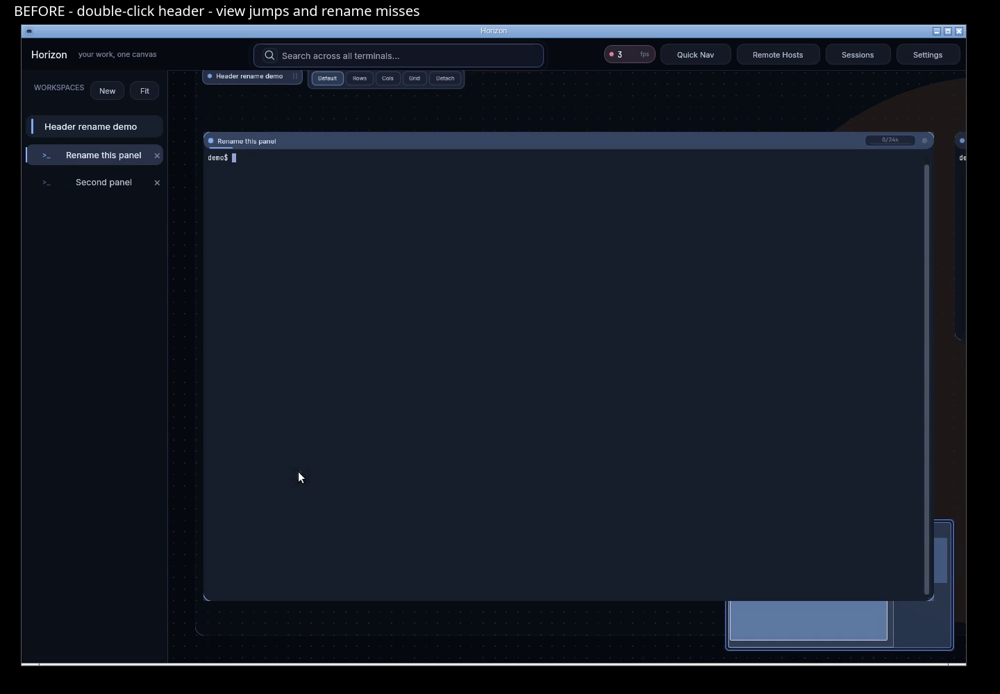
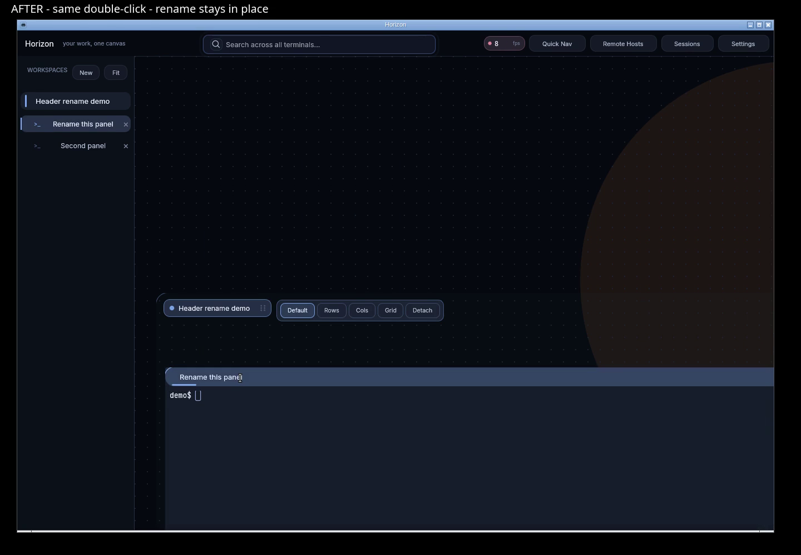

# Panel header interaction evidence

Candidate: `c1e96439e333e9020de89171a52b3ad6b7833368`. Baseline: `7415fdd`.

- [Before and after: identical double-click gesture](header-rename-before-after.mp4)
- [Candidate through the native VNC validation fixture](native-vnc-rename.mp4)

The baseline first click reveals the oversized panel, changing pan/zoom and moving the header before the second click lands. The candidate focuses on the first click and opens rename on the second, preserving the view.

Both recordings use disposable Linux/X11 desktops and synthetic terminal content. The before/after comparison uses the same layout, window size, and 130 ms double-click interval. The candidate was also viewed live in a native Horizon Device panel: connected, visible, image received/displayed, with advancing frames.

Candidate debug binary SHA-256: `a2c928500a1f00fdf9551b6617da7d26f50b552ff10bc827b46a8d4e2f87c03b`.

Passed native smoke: single click; rename and commit; Unicode; Escape cancellation; empty-name rejection; navigation and Fit; panel drag and resize; window resize; detached rename and reattach; saved-session switch and restore.

